<div align="center">
  
</div>

# Cloudflare Tunnel en una MiniPC

> **In English.** An executable runbook that installs `cloudflared` as a hardened systemd service on a Debian or Ubuntu mini PC or Raspberry Pi (x86_64 or arm64), with the QUIC kernel tuning Cloudflare recommends, so a device in a customer's home is reachable without opening router ports. The script asks for the tunnel token without echoing it, so it never lands in the shell history. The manual also covers SSH access through the same tunnel behind Cloudflare Access, troubleshooting and token rotation. Apache 2.0.

Runbook **ejecutable** para dar acceso remoto seguro a una MiniPC o una Raspberry Pi instalada en casa de un cliente, sin abrir puertos en su router: instala `cloudflared`, lo deja como servicio de systemd y ajusta el kernel para QUIC. Es el paso que NEZU repite en cada equipo nuevo, convertido en un script para que salga igual todas las veces.

El repositorio no contiene secretos. El token del túnel se escribe en el momento de instalar, sin que se vea, y queda solo en el equipo.

## Requisitos

- Debian o Ubuntu con `apt` y systemd, en x86_64 o arm64. Probado en una MiniPC y en una Raspberry Pi 4 con Ubuntu 26.04.
- Usuario con `sudo`.
- Una cuenta de Cloudflare con el dominio que vas a usar y acceso a Zero Trust.

## 1. Prepara el túnel en Cloudflare

En [Cloudflare Zero Trust](https://one.dash.cloudflare.com/):

1. **Networks → Tunnels → Create a tunnel**, tipo **Cloudflared**. Ponle el nombre del cliente o del equipo.
2. Copia **solo el token**: la cadena larga que empieza por `eyJ` dentro del comando que muestra Cloudflare.
3. Publica el servicio del equipo en el túnel: un nombre como `casa.ejemplo.com` con el servicio `http://localhost:8080`. En el panel nuevo el tipo va al principio de la URL: `http://` para una página web.

Sin el paso 3, el túnel conecta pero no lleva a ninguna parte. El detalle, en el [manual](docs/manual.md#0-obtener-el-token-del-túnel).

## 2. Instala en el equipo

```bash
git clone https://github.com/NezuSas/nezu-cloudflared-runbook.git
cd nezu-cloudflared-runbook
sudo bash scripts/setup-cloudflared.sh
```

El script pide el token: pégalo y pulsa Enter. No se ve al escribirlo y no queda en el historial de la terminal.

Para instalar sin preguntas, por ejemplo desde otro script, pasa el token en la variable `TUNNEL_TOKEN` y conserva solo esa variable al usar `sudo`:

```bash
sudo --preserve-env=TUNNEL_TOKEN bash scripts/setup-cloudflared.sh
```

No uses `sudo -E`: el `sudo-rs` de Ubuntu 26.04 lo ignora sin avisar y el token no llega al script.

## 3. Comprueba

El script ya espera a que el túnel conecte y termina con error si no lo logra en 30 segundos. Para revisarlo más tarde:

```bash
systemctl status cloudflared --no-pager
sudo journalctl -u cloudflared -n 50 --no-pager
```

En los registros debe aparecer `Registered tunnel connection`, y en el panel el túnel figura como **HEALTHY**. La prueba final es abrir el nombre público desde fuera de la red del equipo.

## Qué hace el script

1. Pide el token sin mostrarlo, si no llegó en la variable `TUNNEL_TOKEN`, y comprueba que tenga forma de token.
2. Añade el repositorio de paquetes de Cloudflare (el paquete no está en Debian ni en Ubuntu) e instala `cloudflared`.
3. Crea el usuario `cloudflared`, sin shell, y el directorio `/etc/cloudflared`.
4. Guarda el token en `/etc/cloudflared/cloudflared.env` con permisos `0640` y propietario `root:cloudflared`. El servicio lo lee de ahí como variable de entorno: nunca aparece en la línea de comandos ni en `ps`.
5. Registra el servicio en systemd con reinicio automático y el proceso acotado (`NoNewPrivileges`, `ProtectSystem`, `ProtectHome`, `PrivateTmp`).
6. Aplica los ajustes de `sysctl` que recomienda Cloudflare para QUIC y arranca el servicio.
7. Espera a que los registros confirmen `Registered tunnel connection`; si no llega en 30 segundos, muestra el estado y termina con error.

Se puede volver a ejecutar las veces que haga falta: cada paso deja el equipo igual si ya estaba hecho. Para hacerlo a mano o auditarlo paso a paso, está el [manual](docs/manual.md).

## Acceso por SSH

El mismo túnel puede dar acceso por SSH al equipo desde cualquier red, sin abrir el puerto 22 y con **Cloudflare Access** delante, que exige iniciar sesión con un correo autorizado. En resumen:

1. Se publica un segundo nombre en el túnel con el servicio `ssh://localhost:22`.
2. Se crea una aplicación de Access para ese nombre, con los correos autorizados, y se activa «Protect with Access» en el túnel para que el propio equipo compruebe el permiso.
3. En el PC basta `cloudflared` y una entrada en `~/.ssh/config` con `cloudflared access ssh`.

Los pasos completos, con la configuración para Windows, Linux y macOS, están en la [sección 8 del manual](docs/manual.md#8-acceso-por-ssh-con-cloudflare-access-opcional). Nunca publiques el SSH sin Access delante.

## Desinstalar

```bash
sudo bash scripts/uninstall-cloudflared.sh          # detiene el servicio y borra token, unidad y sysctl
sudo bash scripts/uninstall-cloudflared.sh --purge  # además desinstala el paquete, el usuario y el repositorio
```

Después borra el túnel en el panel de Cloudflare para que sus nombres dejen de existir. Si diste acceso por SSH, borra también su aplicación de Access.

## Problemas frecuentes

| Síntoma | Qué hacer |
|---|---|
| `Invalid tunnel secret` | El token está incompleto o es de otro túnel. Vuelve a ejecutar el script y pega el token correcto. |
| `Falta el token del túnel` | El script no está en una terminal y no recibió `TUNNEL_TOKEN`. Ejecútalo en una terminal, o con `sudo --preserve-env=TUNNEL_TOKEN`. |
| Tarda en conectar y los registros hablan de `quic` | La red bloquea UDP 7844: añade `TUNNEL_TRANSPORT_PROTOCOL=http2` a `/etc/cloudflared/cloudflared.env` y reinicia el servicio. |
| Túnel HEALTHY pero el nombre público da 502 | El servicio local no responde donde dice el panel: prueba `curl -I http://localhost:8080` en el equipo. |
| `websocket: bad handshake` al entrar por SSH | El SSH está publicado como `http://localhost:22`: cámbialo a `ssh://localhost:22` en el panel. |

Más casos y su explicación, en el [manual](docs/manual.md#problemas-frecuentes).

## Estructura

```text
scripts/setup-cloudflared.sh         instalación y configuración del servicio
scripts/uninstall-cloudflared.sh     desinstalación limpia
templates/cloudflared.env.template   plantilla del archivo de entorno, sin token
docs/manual.md                       manual paso a paso, token, SSH con Access, problemas y rotación
CHANGELOG.md                         cambios de cada versión
```

Los scripts pasan `shellcheck` sin avisos y están escritos como funciones, de modo que cada paso se puede ejecutar y probar por separado; así se comprobó la instalación en un contenedor Debian limpio.

## Seguridad

- El token da acceso al túnel: trátalo como una contraseña y rótalo si se expone. No lo escribas en archivos, chats ni capturas, ni lo pongas a la vista en la línea de comandos.
- En el equipo solo lo leen `root` y el grupo `cloudflared`, y nunca viaja como argumento del proceso.
- Nunca confirmes tokens, credenciales ni archivos `.env` con valores reales en un repositorio.
- La ruta pública la define el túnel en el panel de Cloudflare; este script no abre nada hacia internet por sí mismo. El SSH solo debe publicarse con Cloudflare Access delante.
- El paquete se instala desde el repositorio oficial de Cloudflare, firmado con su clave, nunca desde un binario descargado a mano.

## ¿Lo necesitas en tu instalación?

Este runbook es gratuito: lo publicamos porque es el que usamos en nuestros propios equipos. Si quieres acceso remoto seguro a tus equipos sin abrir puertos y prefieres que lo montemos y lo mantengamos nosotros, [cuéntanos qué necesitas](https://nezuecuador.com/es/contacto) y te respondemos con una propuesta concreta. Aquí está [lo que hacemos](https://nezuecuador.com/es/servicios).

## Licencia

Apache 2.0: puedes usar, modificar y redistribuir este código, también en proyectos comerciales, conservando el aviso de copyright. La licencia no concede derechos sobre la marca NEZU. Texto completo en [LICENSE](LICENSE).

---

<div align="center">
  <sub>Parte del ecosistema <a href="https://github.com/NezuSas">NEZU</a> · <a href="https://nezuecuador.com">nezuecuador.com</a> · © NEZU S.A.S. · Licencia Apache 2.0.</sub>
</div>
